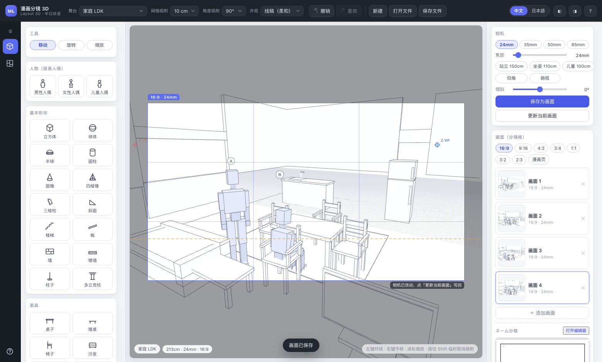
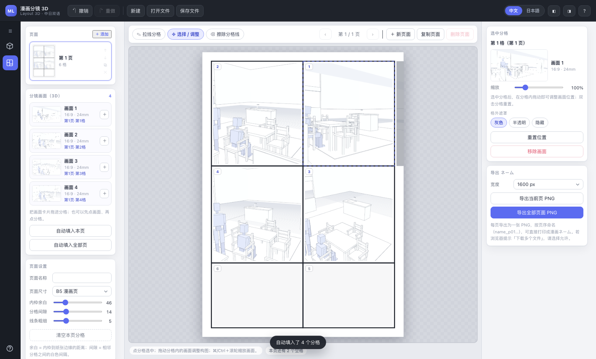
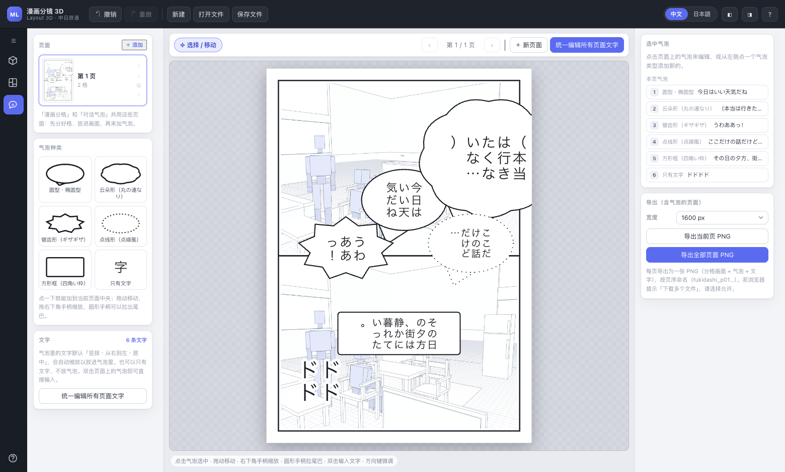
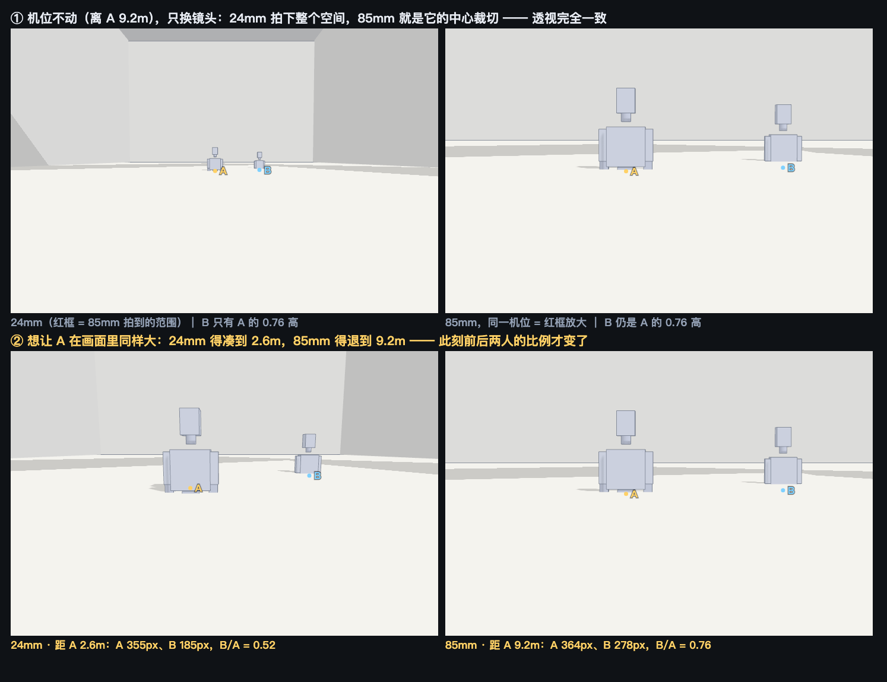

# マンガ レイアウト 3D

[中文](README.md) ｜ [**日本語**](README.ja.md)

**日中バイリンガル（中文 / 日本語）のマンガ レイアウト 3D ツール** — ブラウザで舞台と人物を置き、カメラで切り取ったカットを、自分で線を引いて割ったコマにドラッグして配置。そのまま「ふきだし」でセリフ・心の声・ナレーションを入れ、ネーム全体をページごとに PNG 書き出しできます。

- フロントエンドのみ（Three.js r169 同梱・オフライン動作）＋ 依存ゼロのローカル静的サーバー
- アップロードは一切なし。プロジェクトも自動保存も、あなたのブラウザの中だけ

---

## 起動

| 環境 | 手順 |
| --- | --- |
| macOS | **`start.command`** をダブルクリック（初回は「システム設定 → プライバシーとセキュリティ」で許可が必要な場合があります） |
| Windows | **`start.bat`** をダブルクリック |
| コマンドライン | `node server.mjs 8765` または `bash start.sh` |

ブラウザが自動で <http://127.0.0.1:8765/index.html> を開きます。ターミナルを閉じれば停止します。

初回（このマシンに自動保存のプロジェクトが無いとき）は**ギリシャ神殿（外観）＋ 線画＋明暗**のサンプル状態で開きます。神殿正面のカメラ、5m グリッド、広場に縮尺確認用の人形が 2 体。
以降は毎回、前回の続き（自動保存）から再開します。この初期状態に戻したいときはブラウザのデータを消すか、ツールバーの「新規」で空のプロジェクトを作ってください。
**Node.js 18+** が必要です（静的配信のみ・ネット接続不要・依存インストール不要）。

---

## 主な機能

### 1. 舞台プリセット
- **屋外**：住宅街、商店街、交差点、森林、河原、校庭、駅のホーム、ギリシャ神殿（外観）、江西の古民居（外観）、**旧岩崎邸（外観）**、**廬山の民家（外観・滝）**
- **屋内**：豪邸の大広間、ファミリー LDK、六畳間、教室、オフィス、カフェ、ギリシャ神殿（内陣）、江西の古民居（内観）、**旧岩崎邸 洋館（内観）**、**旧岩崎邸 和館（内観）**
- **人物のみ**：床＋グリッドだけ

> ギリシャ神殿はパルテノン神殿の実測比率で構築：長さ 69.5m × 幅 30.9m、三段の基壇、8×17 本のドーリス式列柱（柱高 10.3m・柱底 ⌀1.9m・柱間 4.29m）。外観にはエンタブラチュア／トリグリフ／ペディメント、内陣は 19.2×30m で二重の Π 字型列柱、11m のアテナ像と反射する水盤を配置。素材ライブラリに「ドーリス式柱」を追加し、単体でも使えます。

> **旧岩崎邸**（東京・湯島、1896 年竣工、ジョサイア・コンドル設計）は 3 棟とも制作：外観は木造二階建ての**洋館**（ジャコビアン様式：急勾配屋根、切妻破風、煉瓦煙突、ドーマー窓、庭園に面した二階建てベランダと対の上げ下げ窓）＋ 平屋の**和館**（瓦屋根の深い軒、格子障子、広縁）＋ **撞球室**と渡り廊下。芝生・砂利道・池・雪見灯籠・松と桜・煉瓦塀の門柱付き。洋館の内観は吹き抜けの**玄関ホール＋大階段**（木製手すりと格子手摺子）、**大広間**（金唐革紙の壁紙＋暖炉＋格天井＋シャンデリア）、**食堂**（長テーブル＋椅子 8 脚）と寄木細工の廊下。和館の内観は書院造の**大広間**（畳、床の間＋違い棚＋欄間、格子障子、池庭に面した広縁）。

> **江西の古民居**は贛派（徽派の影響）民居の形式を参考にしています。外観は青煉瓦と灰瓦の村の路地——三段の馬頭壁、磚雕の門罩と石庫門、木格子窓と妻壁の漏窓、青石板の路地、老いたクスノキと路地奥の池。内観は三間取りの「**四水帰堂**」の中庭——木柱と石基礎、冬瓜梁、太師壁の前には長机・八仙卓・太師椅子、扁額と対聯、隔扇扉窓、二階の回廊。中庭の下には石段・排水溝・石甕もあります。

> **廬山の民家（外観・滝）**：贛派の民家が崖下の石積みテラスに建ち、背後の三段の崖壁から 45m の**直瀑**が落ちます（滝口の岩唇 → 縦縞の水帘 11 本 → 滝壺の水台、泡の輪と水しぶきのある岩潭へ）。小川は滝壺から石段を回って手前へ流れます。標高 45m の崖上、斜面の松、背後の三枚の遠山シルエットが奥行きを作ります。滝の両側の崖壁には**張り出した岩棚**（左は高さ 22.6m、右は 12.8m、苔の上面は約 10×9m）があり、面が平らなので人形をドラッグして立たせられます（ドロップはカーソル下の上向きの面に落ちます：岩棚・家具・テラスすべて同じ）。

舞台を切り替えても、**あなたが置いた家具と人物は残ります**（舞台レイヤーとオブジェクトレイヤーを分けて管理）。
「マイ舞台」で今の部屋をブラウザに保存し、次回ワンクリックで再利用できます（例：主人公の部屋）。

### 2. グリッド吸着
- グリッドは 10cm / 50cm / 1m / 5m、オフにもできます。屋外の舞台は自動で 1m、屋内は自動で 10cm
- **ドラッグ中に Shift** で一時的に吸着オフ
- 角度スナップ 90° / 45° / 15°、オフにもできます
- **高さ吸着**：コップや本を机の上にドラッグすると、机の高さに自動で乗ります
- **壁吸着**：壁に近づけると自動で揃います
- オブジェクトが床より下に落ちることはありません

### 3. カメラ（マンガ用）
- 焦点距離 24mm / 35mm / 50mm / 85mm をワンクリック、スライダーで 18–120mm も可
- **被写体サイズを固定**（オン / オフ）：オンにするとレンズ変更時にカメラが視線方向へ自動で前後し、被写体の画面内サイズを保ったまま前後の大小比（パース）が変わります——誇張したいなら寄る、圧縮したいなら下がる
- 目線プリセット：立ち 150cm、座り 110cm、アオリ、俯瞰
- 傾き（ダッチアングル）−30°～+30°
- 画面比：16:9 / 9:16 / 4:3 / 3:4 / 1:1 / 3:2 / 2:3 / マンガページ
- **カットごとにカメラを個別保存**でき、名前を付けて切り替え（カット 1、カット 2…）。1 ページに複数コマがあっても構図が干渉しません

### 4. 人物（簡易人形）
- 人形は 3 種：**男性 / 女性 / 子ども**（ブロック構成の簡易人形）
- **身長は cm 指定**（例：子ども 115cm、主人公 172cm）
- ポーズプリセット：立ち / 座り / 歩き / 指差し / 寝（左パネル「人物」でポーズを選んでから追加できます）
- 頭に向き（鼻）のマーカー、頭上に名前ラベル（A、B… 名前は変更可）
- 家具と人物の比率は常に正しい（すべて実寸 cm で計算）

### 5. 見た目と書き出し
- 見た目：**線画（ソフト）**、線画（濃い）、明暗彩色、線画＋明暗
  - 線画モードでは円柱 / 円錐 / 球に**視点に追従する側影線**を自動で追加：神殿の柱、木の樹冠、石甕のような丸い形体も、線画で輪郭がはっきり出ます（白い面が潰れません）
- **線のチラつき対策**：3D ビューポートは表示解像度の上に 1.5× の内部スーパーサンプリング（SSAA。画素数が予算を超える場合は自動で 1:1 に戻します）を行い、輪郭線は深度を書き込まないようにしました——カメラを回転・移動したときの細線のサブピクセル揺れが目に見えて滑らかになります
- ガイド：三分割線、パース線 / 消失点、アイレベル（地平線）、画面外を暗く
- **人物のみ表示**：背景の物（家具・建物・小道具…）をまとめて消し、人形のポーズや立ち位置だけを確認
- **壁の遮蔽を外す**：屋内の壁 / 天井屋面を隠して「断面」ビューに。屋外や高い位置からでも室内が見えます（PNG 書き出しは常に完全なシーンでレンダリング）
- PNG 書き出し：幅 1024–3840px、画面比はカットと一致
  - **背景を透明**（物と人物だけの透過画像）
  - **レイヤー分け書き出し**：「背景」と「人物」の透過 PNG を 2 枚同時に出力。Clip Studio / Photoshop にそのままレイヤーとして取り込めます

### 6. ネーム分格（コマ割り）
左のドロワーメニューの 2 番目のボタンでこの機能に切り替わります（`3D 分鏡` ⇄ `ネーム分格`）。

- **複数ページ管理**：＋ 新規ページ / ページ複製 / ページ削除 / 並べ替え / 名前変更。ページサイズは B5 マンガページ、正方形、横長、縦長（Webtoon）から選択
- **線を引いてコマ割り**：マウス（トラックパッド）でページ上に線を引くと、その線が通ったコマが自動で分割されます（斜め線・折れ線も可）。水平 / 垂直は自動スナップ、`Shift` で解除
- **コマ線の消去**：コマ線をクリックすると削除され、隣のコマが自動で 1 つに戻ります（`⌘/Ctrl+Z` で取り消し）
- **ページ設定**：内枠の余白、コマ間の隙間、線の太さをリアルタイム調整
- **3D で保存したカットをコマに入れる**（3 通り・切り抜きは自動）
  - 「カット（コマ枠）」リストのカードを**ドラッグ** → サムネイルページやコマ割りエディタの任意のコマへ
  - 左のカットリストで**カットを選択**してから**コマをクリック**
  - **このページに自動配置 / 全ページに自動配置**：未配置のカットを読み順に空きコマへ
- **コマ内の構図調整**：コマを選んでドラッグでカットを移動、`⌘/Ctrl + ホイール` か右側のスライダーで拡大縮小、ダブルクリックでリセット
- **コマ外マスク**：選択中のコマでは「そのコマからはみ出す部分」を**グレー / 半透明**で表示（非表示も選べます）。そのコマで最終的に何が見えるかが一目で分かります
- **コマ番号**：マンガの読み順（右から左、上から下）で自動採番。カットカードには「1 ページ目・2 コマ目に入れた」表示も付きます
- **書き出し**：現在のページ、または全ページを PNG 出力（例 `name_p01_1600x2262.png`）。ページ順に 1 冊のネームになります

### 7. ふきだし
左のドロワーメニューの 3 番目のボタン（`ネーム分格` ⇄ `ふきだし`）。**「ネーム分格」と同じページを共有**します——先にコマ割りとカット配置を済ませ、ここでセリフを入れます。

- **5 種類のふきだし＋文字だけ**：クリックで現在のページ中央に追加
  - **丸型・楕円型**：通常の会話や呼びかけに使われる最も基本的な形
  - **丸の連なり**：声に出していない心の声や内面のつぶやき
  - **ギザギザ型**：叫び声や怒り、驚きなどの強い感情
  - **点線風**：小声や内緒話
  - **四角い枠**：場面説明やナレーション
  - **文字だけ**：ふきだし無しで文字のみ（ナレーション / 擬音）
- **文字は既定で「縦書き・右から左・中央揃え」**：ふきだしの形に合わせて自動で段組み＆縮小し、入りきらないときは自動で小さくなります。横書きへの一括変更も可。縦書きでは**1 段あたり最低 4 文字**、自動縮小は 1 段にできるだけ多く入るように調整（初期バージョンより 1 段あたり約 2 文字多い）。1 段に 1〜2 文字しか入らない状態にはなりません
- **編集**：ドラッグで移動、右下ハンドルで拡大縮小、丸ハンドルでしっぽ（引き出し線）を引き出し、傾きスライダーで回転。ダブルクリックで文字を直接入力。`サイズ` スライダーで文字を一括拡縮。「文字に合わせる」でふきだしを文字ぴったりに縮めます
- **一括編集**：「全ページの文字を一括編集」で全ページの文字をまとめて変更。**全ページ縦書き / 横書き**の切り替え、**文字サイズの統一**も可能。キャンセルで元に戻り、OK 後は 1 回の `⌘/Ctrl+Z` で取り消せます
- **書き出し**：現在のページ、または全ページを PNG 出力（コマ絵＋ふきだし＋文字を 1 枚に合成、`fukidashi_p01_1600x2262.png`）。そのまま印刷したり Clip Studio に貼り付けたりできます

---

## スクリーンショット

| 3D 分鏡（右にネームのサムネイル、カットをコマへドラッグ可） | ネーム分格：線でコマ割り＋カット配置＋コマ外グレーマスク |
| --- | --- |
|  |  |

| ふきだし：割ったコマにセリフ / 心の声 / ナレーション / 擬音を入れる |
| --- |
|  |

---

## ショートカット

| 操作 | 説明 |
| --- | --- |
| 左ドラッグ / 右ドラッグ / ホイール | 視点を回す / 平行移動 / ズーム |
| 矢印キー | 視点を平行移動（Shift で加速） |
| R を押しながら矢印キー | 視点を回す（← → 水平、↑ ↓ カメラ高さ） |
| `W` `E` `R` | 移動 / 回転 / 拡大縮小ツール |
| `Shift` を押しながらドラッグ | 一時的に吸着オフ |
| `F` | カメラを選択オブジェクトに向ける |
| オブジェクトをダブルクリック | カメラを向けて寄る |
| `Delete` / `Backspace` | 選択オブジェクトを削除 |
| `⌘/Ctrl + D` | 選択オブジェクトを複製 |
| `⌘/Ctrl + Z` / `⇧ + ⌘/Ctrl + Z` | 取り消し / やり直し |
| `⌘/Ctrl + S` | プロジェクトを JSON で保存 |
| `Esc` | 選択解除 |
| **ネーム分格モード** | |
| `L` / `V` / `E` | 線で分割 / 選択・調整 / コマ線の消去 |
| ページ上でドラッグ | 線を引いてコマ割り（Shift で水平垂直スナップ解除） |
| コマ内のカットをドラッグ | コマ内でのカット位置調整 |
| `⌘/Ctrl + ホイール` | コマ内カットの拡大縮小 |
| コマをダブルクリック | カット位置と拡大率をリセット |
| `Delete` | 選択コマのカットを外す |
| `PageUp` / `PageDown` | 前のページ / 次のページ |
| `⌘/Ctrl + D` | 現在のページを複製 |
| **ふきだしモード** | |
| ふきだしをクリック | 選択（何も無い所を再度クリックで解除） |
| ふきだし / 右下ハンドル / 丸ハンドルをドラッグ | 移動 / 拡大縮小 / しっぽを引き出す |
| ふきだしをダブルクリック | 文字を直接入力（右パネルの入力欄） |
| 矢印キー / `⇧ + 矢印キー` | 位置の微調整（小刻み / 大きく） |
| `Delete` / `Backspace` | 選択中のふきだしを削除 |
| `⌘/Ctrl + D` | 選択中のふきだしを複製 |
| `PageUp` / `PageDown` | 前のページ / 次のページ |

---

## おすすめの流れ

1. 上部で**舞台**プリセットを選ぶ（屋内 / 屋外とグリッド精度が決まります）
2. 左から家具・基本形状・人物を画面へドラッグ（ボタンをクリックでも追加できます）
3. カメラ調整：焦点距離、目線プリセット、画面比、傾き
4. **カットとして保存**を押してこの 1 コマを記録 → カメラを動かす → 次のコマを保存
5. **PNG 書き出し**でサイズを選んで下書きを出力（透過背景・レイヤー分けも可）
6. 左のドロワーの**ネーム分格**へ：＋ 新規ページ → 「線で分割」でページを何コマかに割る
7. 「カット（コマ枠）」のカットをコマへドラッグ（または「自動配置」）、コマを選んで構図を微調整
8. ページを増やすときは ＋ を続け、最後に「全ページを PNG 書き出し」で 1 冊のネームが完成
9. 左のドロワーの**ふきだし**へ：左のふきだし種別をクリックしてページに追加 → ダブルクリックでセリフ入力（既定は右から左の縦書き）→ ハンドルで大きさ / しっぽを調整
10. 「全ページの文字を一括編集」で全ページのセリフをまとめて変更 → 「全ページを PNG 書き出し」で、セリフとふきだしが各ページに合成されます

---

## コツ（実測ベース）

- **レンズが決めるのは画角、パースを決めるのはカメラ位置**：同じ位置なら 85mm は 24mm の中心を 85/24 ≈ 3.5 倍に切り出しただけで、パースは完全に同じです。誇張したいなら広角で寄る、圧縮したいなら望遠で下がる——カメラパネルの「**被写体サイズを固定**」をオンにすれば自動で前後します。

  
- **目線の高さ**で絵の自然さが決まります：座りは目線 110cm、立ちは 150cm 程度。カメラを人物の目の高さに合わせるだけで、構図が一気にマンガらしくなります。
- 見た目を「**線画（ソフト）**」＋白背景にすると、そのまま Clip Studio の下書きレイヤーに貼れる描線用の下地になります。
- 寸法はすべて実寸 cm。家具と人物の比率は常に正しく、高さ吸着で物を机の上に直接置けます。
- **舞台を切り替えても置いたオブジェクトは残ります**。家具を先に組んでから背景を変える、という進め方ができます。

---

## ファイル構成

```
index.html          UI 構造
styles.css          スタイル
src/app.js          メイン：シーン、カメラ、吸着、書き出し、ショートカット、モード切替
src/name.js         ネーム分格：複数ページ、線でコマ割り、カット配置、ページ書き出し
src/bubble.js       ふきだし：形状と縦書き、一括編集、ネーム全体の書き出し
src/objects.js      素材モデリング：基本形状、家具、家電、簡易人形、輪郭線
src/stages.js       舞台プリセットと共有モデリングヘルパー（kit）（屋外 / 屋内 / 人物のみ）
src/scenes/         独立シーンモジュール：ギリシャ神殿、江西の民居 内外観、旧岩崎邸 外観 / 洋館内観 / 和館内観、廬山の民家（外観・滝）
docs/scene-authoring.md  シーンモジュールの書き方ガイド（今後シーンを追加する人向け）
src/i18n.js         日中バイリンガルの文言テーブル
vendor/three/       Three.js r169（同梱・オフライン動作）
server.mjs          依存ゼロのローカル静的サーバー
start.command/.sh/.bat  起動スクリプト
node_modules/       初回の Three.js 取得専用。実行時は未使用（gitignore 済み）
```

## データについて

すべてローカルのブラウザ内で完結します。データは送信されません。
プロジェクトは「保存ファイル」で JSON に書き出し（3D シーン＋ネームのページが 1 ファイルに入ります）、「ファイルを開く」で続きから進められます。「マイ舞台」と自動保存はブラウザの localStorage に保存されます。
